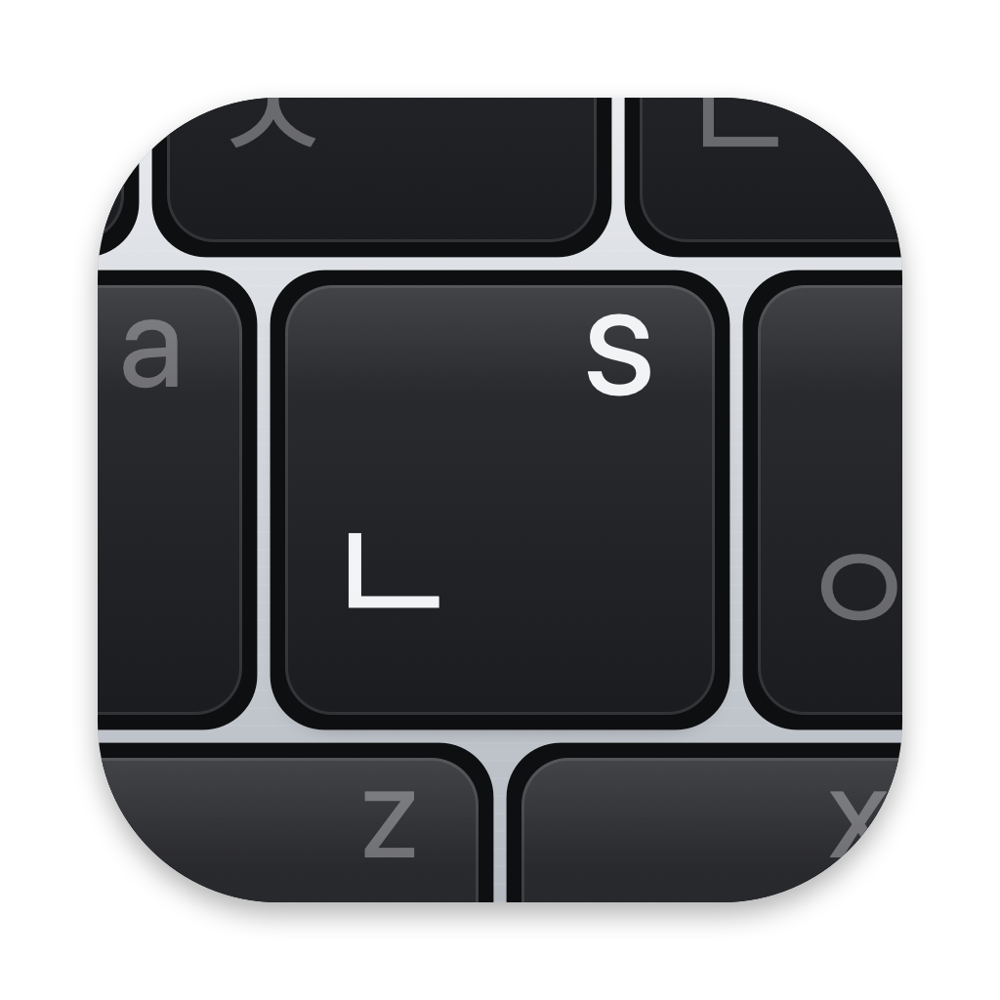

<p align="center">
  
</p>

<h1 align="center">SpaType</h1>

<p align="center">입력 소스를 잘못 두고 친 글자를 알아채서, 원래 치려던 언어로 다시 쳐주는 macOS 메뉴바 앱</p>

<p align="center"><a href="README.md">English</a> · <b>한국어</b></p>

> 이름은 한글 사용자가 가장 많이 내는 오타에서 왔어요. "넴"을 영어 자판으로 치면 `spa`.

`gksrmffh rkqwkrl` → **한글로 갑자기**. 잘못 친 글자를 감지하면 caret 옆에 바로잡은 결과를 띄우고, **Tab**(또는 **⇧ 두 번**)을 누르면 지우고 → 입력 소스를 바꾸고 → 같은 키를 다시 쳐줘요.

한영만 다루는 게 아니라, 시스템에 켜둔 입력 소스끼리라면 어떤 조합이든 감지해요 (en↔ko, en→ja, en↔ru, en↔el …).

## 기능

- **문장 단위 교정**: 첫 감지 후 계속 쳐도 문장 전체를 모아 한 번에 고쳐요. 중간 오타, 숫자, 짧은 단어도 함께 묶어요.
- **실시간 감지**: 평소에는 스페이스나 잠깐 멈췄을 때(0.35초) 판정하고, 한 번 감지된 뒤에는 키를 칠 때마다 미리보기가 바뀌어요. Enter로 다음 줄로 넘어가도 이어서 감지해요.
- **자동 변환**: 잘못 친 글이 길어지면(기본 16타) Tab 없이 스페이스에서 바로 바꿔요. 그 사이 친 키는 바꾼 뒤 새 입력 소스로 이어서 입력돼요. 메뉴 → **설정…**에서 끄기 / 약하게(24타) / 보통(16타) / 강하게(10타)로 조절하고, 기본값으로 초기화할 수 있어요.
- **자주 내는 오타**: `spa`(넴), `spq`(넵), `sp`(네), `dmd`(응), `gjf`(헐) 같은 짧은 답장은 영어 단어여도 제안해요.
- **방해하지 않는 UI**: 포커스를 뺏지 않는 패널. 무시하고 계속 치면 사라져요. Tab은 패널이 떠 있을 때만 가로채요.
- **온디바이스**: 입력 내용은 저장하지도, 내보내지도 않아요. 네트워크는 업데이트 확인(GitHub, 하루 한 번)에만 써요.

## 설치

1. [Releases](https://github.com/henrynoowah/SpaType/releases/latest)에서 `SpaType-<버전>.zip`을 받아 압축을 풀고, `SpaType.app`을 `응용 프로그램` 폴더로 옮겨요.
2. Apple 공증(notarization)을 받지 않은 앱이라 처음 열 때 macOS가 막아요. **우클릭 → 열기**를 누르거나, 시스템 설정 → 개인정보 보호 및 보안 아래쪽의 **그래도 열기**를 눌러요.
3. **손쉬운 사용**과 **입력 모니터링**에서 SpaType을 허용해요. 메뉴바의 키캡 아이콘이 흐린 상태에서 선명해지면 동작 중이에요.

Apple silicon과 Intel Mac 모두 지원하는 유니버설 앱이에요.

새 버전이 나오면 메뉴바 메뉴에 **SpaType <버전> 설치…**가 떠요. 누르면 받아서 서명을 확인하고 교체한 뒤 다시 실행해요. 권한은 그대로 유지돼요.

## 요구 사항

- macOS 13 이상
- Xcode (Swift 5.9+). Command Line Tools만으로는 `swift test`의 XCTest가 없어요. `sudo xcode-select -s /Applications/Xcode.app/Contents/Developer`

## 소스에서 빌드

```bash
swift test                    # 엔진 단위 테스트 (판정 로직, 두벌식, 로마자)
./scripts/make-dev-cert.sh    # (한 번만) 로컬 서명 인증서 만들기 — 아래 참고
./scripts/bundle.sh --run     # build/SpaType.app 생성 후 실행
```

처음 실행하면 **손쉬운 사용**과 **입력 모니터링** 권한을 요청해요. 시스템 설정 → 개인정보 보호 및 보안에서 SpaType을 허용하면 2초 안에 자동으로 감지를 시작해요 (메뉴바 키캡 아이콘이 흐림 → 선명).

> **권한은 앱 서명에 묶여 있어요.** ad-hoc 서명은 빌드할 때마다 바뀌어서 macOS가 권한을 잊어버려요. `scripts/make-dev-cert.sh`로 자체 서명 인증서("SpaType Dev")를 키체인에 한 번 만들어 두면, `bundle.sh`가 그걸로 서명해서 다시 빌드해도 권한이 유지돼요. 다른 인증서를 쓰려면 `SPATYPE_SIGN_IDENTITY="Apple Development: …" ./scripts/bundle.sh`, 권한을 초기화하려면 `tccutil reset Accessibility dev.spatype.SpaType`.

배포용 zip(유니버설)은 `./scripts/release.sh`로 만들어요. 앱 내 업데이트는 현재 앱과 같은 인증서로 서명된 빌드만 설치하므로, 릴리즈는 항상 같은 `SpaType` 인증서로 서명해야 해요 (ad-hoc 서명이면 스크립트가 멈춰요). `v<버전>` 태그를 푸시하면 GitHub Actions가 시크릿(`SPATYPE_CERT_P12`, `SPATYPE_CERT_PASSWORD`)의 인증서로 서명해서 릴리즈를 올려요. 인증서를 잃어버리면 사용자가 직접 다시 설치하고 권한을 다시 줘야 해요. 앱 아이콘은 `scripts/make-icon.sh`로 다시 만들 수 있어요 (`scripts/make-icon.swift`에서 그림).

## 동작 방식

```
키 입력 (event tap — 패널이 떠 있을 때의 Tab만 가로챔)
  → 문자 대신 물리 keyCode + shift를 버퍼에 저장
  → 스페이스, 잠깐 멈춤, 또는 (감지 이후엔) 매 키 입력마다 판정
  → 켜둔 입력 소스마다 같은 키를 다시 해석
       일반 레이아웃: UCKeyTranslate (ABC, Russian, Greek …)
       두벌식: 자체 오토마타
       일본어(로마자): 자체 romaji→hiragana
  → 언어별 점수 비교
       레이아웃: NSSpellChecker (없으면 NLLanguageRecognizer)
       한국어: 낱자모 비율 / 일본어: 로마자로 소비되는 비율
  → "현재 소스로는 말이 안 되고, 다른 소스로는 말이 됨"이면 제안
  → 연속된 단어는 하나의 run으로 묶음 (gksrmffh rkqwkrl qkRuTdmf Eo → 한 번에)
  → caret 아래 non-activating 패널 표시
  → Tab 또는 ⇧⇧: 백스페이스 N번 → TISSelectInputSource → 같은 keyCode 재생
```

교정할 때 완성된 텍스트를 넣지 않고 **키를 다시 치는** 방식이라, 한글 조합이나 일본어 변환은 실제 IME가 직접 처리해요. 일본어로 바꿀 때는 스페이스(변환 키)를 빼고 재생해서 히라가나 조합 상태로 남겨둬요. 거기서 스페이스로 변환하거나 Return으로 확정하면 돼요.

## 코드 구조

| 경로 | 역할 |
|---|---|
| `Sources/SpaTypeCore/` | 플랫폼 독립 엔진. `Engine`(판정 + run 관리), `Dubeolsik`, `Romaji`, `KeyStroke`/`USLayout` |
| `Sources/SpaType/InputSourceCatalog.swift` | 켜둔 입력 소스 목록, UCKeyTranslate 렌더링, 소스 전환 |
| `Sources/SpaType/SpellJudge.swift` | 단어 점수 (NSSpellChecker, 오타는 gibberish로 보지 않음) |
| `Sources/SpaType/KeyMonitor.swift` | CGEventTap. 입력은 보기만 하고, 패널이 떠 있을 때의 Tab만 가로챔 |
| `Sources/SpaType/CaretLocator.swift` | AX로 caret 위치 조회 (Electron은 AXManualAccessibility로 활성화) |
| `Sources/SpaType/SuggestionPanel.swift` | 포커스를 뺏지 않는 반투명 패널 |
| `Sources/SpaType/Corrector.swift` | 삭제 → 전환 → 재생 |
| `Sources/SpaType/AppController.swift` | 이벤트 라우팅, Tab·⇧⇧ 수락, 메뉴바 |

## 안전장치

- 비밀번호 필드(Secure Input)에서는 아무것도 하지 않아요.
- 터미널, VS Code, Cursor, JetBrains, Zed, 비밀번호 관리자는 기본으로 제외돼요 (`AppController.excludedBundlePrefixes`).
- 숫자나 기호가 섞인 단어(코드, URL)와 3글자 미만 단어는 단독으로는 제안하지 않아요 (자주 내는 오타 목록 제외).
- `teh`처럼 편집 거리 1인 오타는 잘못된 입력 소스로 보지 않아요.
- 클릭, 방향키, 단축키, Tab, 앱 전환, 수동 입력 소스 전환 시 추적을 초기화해요. Return은 이미 친 글자는 놔두고 "잘못된 입력 소스" 상태만 다음 줄로 넘겨요.
- 입력 내용은 저장하지도, 내보내지도 않아요. 네트워크는 GitHub Releases 업데이트 확인에만 써요.

## 알려진 한계 (MVP)

- **현재 소스가 일본어일 때**(영어를 일본어 IME로 친 경우)는 아직 감지하지 않아요. 화면에 조합 중인 텍스트가 남아 있어서 지우는 방식이 달라야 해요.
- 지원하는 IME: 두벌식, 일본어 로마자 입력. 세벌식, 병음, 가나 입력, 서드파티 IME는 건너뛰어요.
- 두벌식과 로마자는 US QWERTY 키 위치 기준이에요.
- CJK 입력 소스는 `TISSelectInputSource` 직후 일부 앱에서 전환이 늦게 반영되는 macOS 버그가 있어요. SpaType은 전환이 확인될 때까지 기다리고, IME를 처음 쓸 때는 더 기다려요. 그래도 이전 자판으로 재생되면 `Corrector.switchInputSource`의 대기 시간을 늘려보세요.
- Electron 앱에서 caret 위치를 못 얻으면 포커스된 필드나 마우스 근처에 패널이 떠요.
- 앱이 자동 교정 등으로 텍스트를 바꾸면 삭제할 글자 수가 어긋날 수 있어요.

## 다음 단계 아이디어

- 일본어 IME가 현재 소스일 때 감지·교정 (조합 중 텍스트 처리)
- 사용자 사전 / "이 단어는 다시 묻지 않기"
- 제외 앱과 수락 단축키 설정 UI
- 신뢰도가 높을 때만 자동 교정하는 모드
- Developer ID 서명 + notarization으로 배포
- 단어별 n-gram 모델로 짧은 단어 판정 개선

## 라이선스

[MIT](LICENSE)
