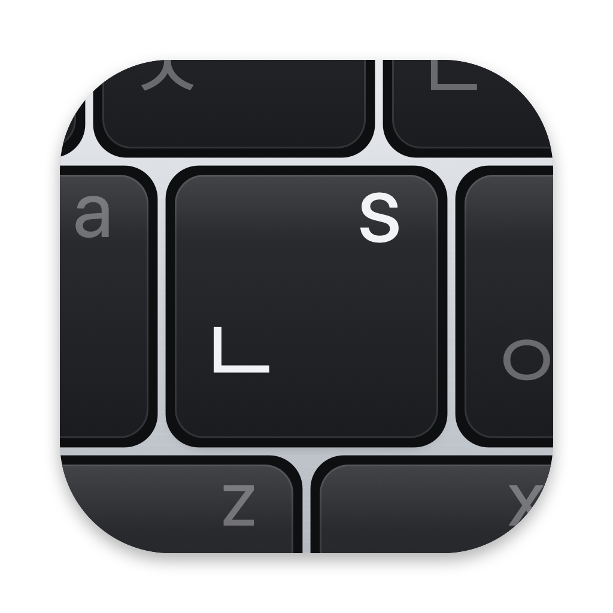

<p align="center">
  
</p>

<h1 align="center">SpaType</h1>

<p align="center">A macOS menu bar app that notices when you typed in the wrong input source and retypes it in the language you meant.</p>

<p align="center"><b>English</b> · <a href="README.ko.md">한국어</a></p>

> The name comes from the most common typo Korean users make: type "넴" ("yep") with the keyboard still in English and you get `spa`.

`gksrmffh rkqwkrl` → **한글로 갑자기**. When SpaType sees text that only makes sense in another of your enabled input sources, it shows the fixed version next to the caret. Press **Tab** (or **Shift twice**) and it deletes what you typed, switches the input source, and replays the same keys.

It isn't limited to Korean and English. Any pair of input sources you have enabled works (en↔ko, en→ja, en↔ru, en↔el …).

## Features

- **Whole sentences**: keep typing after the first detection and the entire sentence is fixed in one go. Typos, numbers and short words in the middle come along.
- **Live detection**: normally a word is judged at a space or after a short pause (0.35 s). Once a slip is detected, the preview updates on every keystroke, and it carries over to the next line after Enter.
- **Common slips**: short Korean replies like `spa` (넴), `spq` (넵), `sp` (네), `dmd` (응) and `gjf` (헐) are suggested even when they happen to be English words.
- **Stays out of the way**: a panel that never takes focus and disappears if you keep typing. Tab is only intercepted while the panel is showing.
- **On-device**: nothing you type is stored or sent anywhere. The only network access is the update check (GitHub, once a day).

## Install

1. Download `SpaType-<version>.zip` from [Releases](https://github.com/henrynoowah/SpaType/releases/latest), unzip it, and move `SpaType.app` to `Applications`.
2. The app isn't notarized by Apple, so macOS blocks it the first time. **Right-click → Open**, or click **Open Anyway** at the bottom of System Settings → Privacy & Security.
3. Allow SpaType under **Accessibility** and **Input Monitoring**. When the keycap icon in the menu bar turns from dimmed to solid, it's running.

The app is universal: it runs on both Apple silicon and Intel Macs.

When a new version is out, the menu bar menu shows **SpaType <version> 설치…** (install). It downloads the release, checks its signature, swaps it in and relaunches; permissions are kept.

## Requirements

- macOS 13 or later
- To build: Xcode (Swift 5.9+). Command Line Tools alone don't include XCTest for `swift test`; run `sudo xcode-select -s /Applications/Xcode.app/Contents/Developer`.

## Build from source

```bash
swift test                    # engine unit tests (judging, 2-set Korean, romaji)
./scripts/make-dev-cert.sh    # (once) create a local signing certificate, see below
./scripts/bundle.sh --run     # build build/SpaType.app and launch it
```

On first launch SpaType asks for **Accessibility** and **Input Monitoring**. Once you allow it in System Settings → Privacy & Security, detection starts within two seconds (the menu bar keycap icon goes from dimmed to solid).

> **Permissions are tied to the app's signature.** Ad-hoc signatures change on every build, so macOS forgets the grant. Run `scripts/make-dev-cert.sh` once to put a self-signed "SpaType Dev" certificate in your keychain; `bundle.sh` signs with it, and permissions survive rebuilds. To use another certificate: `SPATYPE_SIGN_IDENTITY="Apple Development: …" ./scripts/bundle.sh`. To reset permissions: `tccutil reset Accessibility dev.spatype.SpaType`.

`./scripts/release.sh` builds the universal release zip. The in-app updater only installs builds signed with the same certificate as the running app, so every release must be signed with the same `SpaType` certificate (the script refuses ad-hoc builds). Pushing a `v<version>` tag makes GitHub Actions sign with that certificate (secrets `SPATYPE_CERT_P12`, `SPATYPE_CERT_PASSWORD`) and publish the release. Lose it and users have to reinstall by hand and grant permissions again. The app icon can be regenerated with `scripts/make-icon.sh` (drawn in `scripts/make-icon.swift`).

## How it works

```
Key events (event tap — only Tab is intercepted, and only while the panel is up)
  → store the physical keyCode + Shift, not the character
  → judge at a space, a pause, or (after a detection) on every keystroke
  → re-render the same keys through every enabled input source
       plain layouts: UCKeyTranslate (ABC, Russian, Greek …)
       2-set Korean: built-in automaton
       Japanese (romaji): built-in romaji → hiragana
  → score each rendering for its language
       layouts: NSSpellChecker (falls back to NLLanguageRecognizer)
       Korean: share of leftover jamo / Japanese: share of keys consumed as romaji
  → suggest when it's nonsense in the current source but makes sense in another
  → consecutive words form one run (gksrmffh rkqwkrl qkRuTdmf Eo → fixed at once)
  → show a non-activating panel under the caret
  → Tab or ⇧⇧: Backspace × N → TISSelectInputSource → replay the same keyCodes
```

Corrections **replay keys** instead of inserting finished text, so Hangul composition and Japanese conversion are handled by the real system IME. When switching to Japanese the space (conversion key) is left out, so the text stays as composing hiragana; press Space to convert or Return to commit.

## Code layout

| Path | Role |
|---|---|
| `Sources/SpaTypeCore/` | Platform-independent engine: `Engine` (judging + runs), `Dubeolsik`, `Romaji`, `KeyStroke`/`USLayout` |
| `Sources/SpaType/InputSourceCatalog.swift` | Enabled input sources, UCKeyTranslate rendering, switching |
| `Sources/SpaType/SpellJudge.swift` | Word scores (NSSpellChecker; ordinary typos aren't treated as gibberish) |
| `Sources/SpaType/KeyMonitor.swift` | CGEventTap: observes input, swallows Tab only while the panel is up |
| `Sources/SpaType/CaretLocator.swift` | Caret position via Accessibility (enables AXManualAccessibility for Electron) |
| `Sources/SpaType/SuggestionPanel.swift` | Translucent panel that never takes focus |
| `Sources/SpaType/Corrector.swift` | Delete → switch → replay |
| `Sources/SpaType/AppController.swift` | Event routing, Tab / ⇧⇧ accept, menu bar |

## Safeguards

- Does nothing in password fields (Secure Input).
- Terminals, VS Code, Cursor, JetBrains IDEs, Zed and password managers are excluded by default (`AppController.excludedBundlePrefixes`).
- Words with digits or symbols (code, URLs) and words under three letters aren't suggested on their own (except the common-slips list).
- Edit-distance-1 typos like `teh` aren't treated as a wrong input source.
- Tracking resets on clicks, arrow keys, shortcuts, Tab, app switches and manual input-source switches. Return keeps the text already typed but carries the "wrong source" state to the next line.
- Nothing you type is stored or sent. The only network access is the GitHub Releases update check.

## Known limitations (MVP)

- **When the current source is Japanese** (English typed into the Japanese IME), nothing is detected yet; composing text on screen needs a different way to delete.
- Supported IMEs: 2-set Korean and Japanese romaji input. 3-set Korean, Pinyin, kana input and third-party IMEs are skipped.
- 2-set Korean and romaji assume US QWERTY key positions.
- Some apps apply a CJK `TISSelectInputSource` switch late (a macOS bug). SpaType waits until the switch is confirmed (and longer the first time an IME is used); if replays still come out in the old layout, raise the waits in `Corrector.switchInputSource`.
- If an Electron app doesn't report the caret position, the panel appears near the focused field or the mouse.
- If an app changes the text itself (autocorrect), the number of characters to delete can be off.

## Ideas

- Detection and correction while the Japanese IME is the current source
- User dictionary / "don't ask about this word again"
- Settings UI for excluded apps and the accept shortcut
- Auto-correct mode for high-confidence cases
- Developer ID signing + notarization
- Better short-word judging with per-language n-gram models

## License

[MIT](LICENSE)
